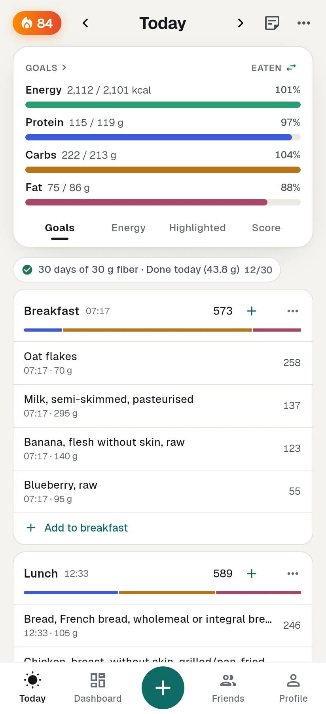
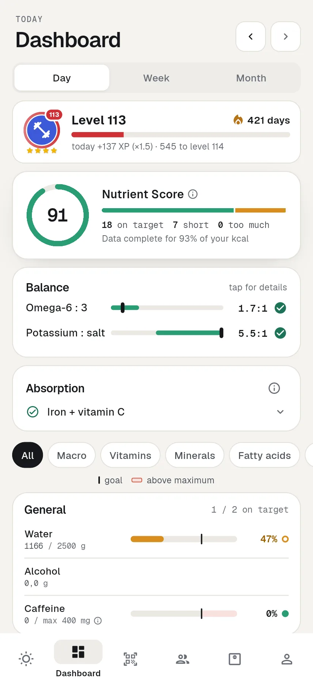
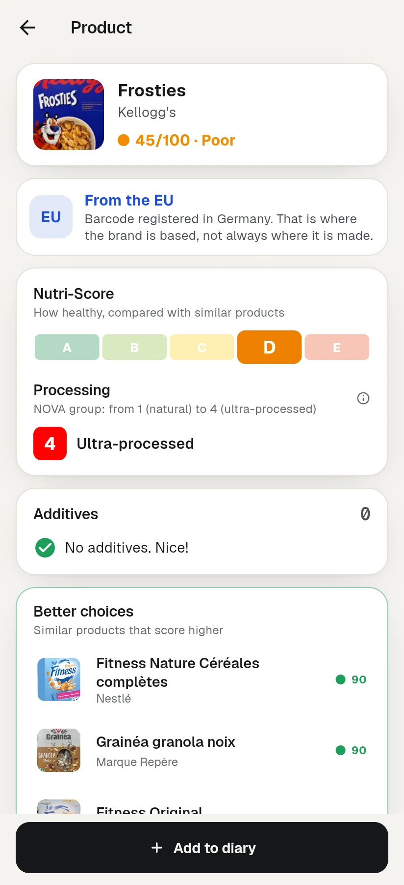
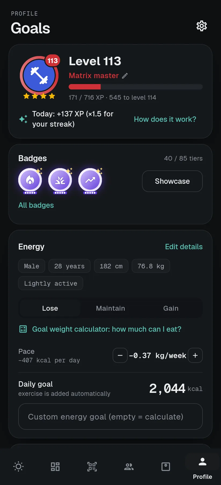

# MacroMatrix

**Know what you eat. Better together.**

MacroMatrix is a food diary that tracks all 69 nutrients (energy, macros, vitamins, minerals, fatty acids and
essential amino acids) against EFSA reference values, with a product scanner that rates additives and flags allergens, and
friends, levels, badges and weekly battles to keep you going. European data first, privacy first.

<p>
  
  
  
  
</p>

- **Website and web app:** https://macromatrix.eu
- **Android:** [GitHub releases](https://github.com/Tanatloc/macromatrix-releases/releases/latest), with automatic
  updates through [Obtainium](https://github.com/ImranR98/Obtainium) (add `https://github.com/Tanatloc/macromatrix-releases`)

## Features

- **Track:** energy, macros and 69 nutrients per day, week and month, with a Nutrient Score, balances
  (omega-6 : omega-3, potassium : salt), absorption tips and "what should I still eat?"
- **Log:** search 15,000+ basic foods and millions of branded products, scan barcodes, say what you ate, favourites,
  recipes, saved meals, supplements and "same as yesterday"
- **Scan:** product score, Nutri-Score, NOVA group, additives with EFSA-based risk levels, your allergens,
  origin (EU, US, other) and better alternatives; works offline for products you scanned before
- **Friends:** friend codes, weekly leaderboard, battles with rivalry records, levels, tiered badges and titles
- **Body:** weight, measurements, fasting, a goal weight calculator and Health Connect import on Android
- **Android extras:** home screen widget, reminders, battle notifications
- English and Dutch, light and dark theme, works offline, export to CSV

## Data sources

| Source | Licence |
|---|---|
| ANSES-CIQUAL 2025 (France) | Licence Ouverte 2.0 (Etalab) |
| Frida, DTU Food Institute (Denmark) | CC BY 4.0 |
| McCance and Widdowson's CoFID 2021 (UK) | Open Government Licence v3.0 |
| Livsmedelsverket (Sweden) | CC BY 4.0 |
| Matvaretabellen, Mattilsynet (Norway) | NLOD |
| Bundeslebensmittelschlüssel (BLS) 4.0, Max Rubner-Institut (Germany) | CC BY 4.0 |
| USDA FoodData Central (US): SR Legacy, Foundation Foods, FNDDS 2021–2023 (dishes) and Branded Foods | Public domain (CC0) |
| Open Food Facts (products, additives) | ODbL |

The values from these tables were converted to common units and definitions, combined, and in places estimated or
corrected (see `tool/FOODS_CHANGES.md`); estimated values are marked with ≈ in the app.

- ANSES. 2025. Ciqual French food composition table (https://ciqual.anses.fr), Licence Ouverte 2.0.
- The Danish Food Composition Database (https://fcdb.fooddata.dk/), version 6.1, National Food Institute, Technical
  University of Denmark (DTU), licensed under [CC BY 4.0](https://creativecommons.org/licenses/by/4.0/); changes were made.
- Contains public sector information licensed under the Open Government Licence v3.0 (McCance and Widdowson's
  Composition of Foods Integrated Dataset 2021, Public Health England / Office for Health Improvement and Disparities).
- Livsmedelsverket, Livsmedelsdatabasen (https://soknaringsinnehall.livsmedelsverket.se), licensed under
  [CC BY 4.0](https://creativecommons.org/licenses/by/4.0/); changes were made.
- Contains data under the Norwegian licence for Open Government data (NLOD) made available by Mattilsynet
  (Matvaretabellen, https://www.matvaretabellen.no).
- Max Rubner-Institut (2025): Bundeslebensmittelschlüssel (BLS), Version 4.0 — Deutsche Nährstoffdatenbank. Karlsruhe.
  DOI: 10.25826/Data20251217-134202-0. Licensed under [CC BY 4.0](https://creativecommons.org/licenses/by/4.0/); changes
  were made.
- U.S. Department of Agriculture, Agricultural Research Service. FoodData Central (https://fdc.nal.usda.gov).
- Open Food Facts (https://world.openfoodfacts.org), available under the Open Database License (ODbL). The additive
  list derived from it, `assets/additives.json`, is likewise available under the
  [ODbL 1.0](https://opendatacommons.org/licenses/odbl/1-0/).

Reference values: EFSA Dietary Reference Values; essential amino acids: WHO/FAO/UNU 2007. **Not medical advice.**

## Building

You need Flutter (stable), Java 21 and the Android SDK.

```bash
flutter pub get
flutter test
flutter run -d linux                                              # desktop
flutter build apk --release --dart-define-from-file=supabase.json # Android
tool/build_site.sh                                                # website + web app in build/site
```

`supabase.json` holds the public URL and anon key of the backend; without it the app works fully offline, without
an account. To run your own backend, create a Supabase project and apply `supabase/migrations/` (see
[supabase/README.md](supabase/README.md)). Release builds are signed with a key that is not in this repository;
without it, Gradle falls back to the debug key.

More (in Dutch): [docs/ONTWIKKELEN.md](docs/ONTWIKKELEN.md).

## Structure

- `lib/nutrition/`: nutrients, reference values, scores, badges, levels, parsing of quick logs
- `lib/data/`: built-in food database, Open Food Facts and USDA clients, local user database
- `lib/sync/`: accounts, sync and friends (Supabase)
- `lib/ui/`: screens and widgets
- `functions/api/`: Cloudflare Pages Functions (search proxy, USDA lookup, speech to text, photo logging, label scan, recipe import, sharing with Open Food Facts); shared helpers in `functions/_lib/`. Sharing needs the secrets `OFF_USER` and `OFF_PASSWORD`
- `supabase/migrations/`: database schema with row level security
- `tool/`: build scripts for the food database, the site and releases

## Contributing

Bug reports and ideas are welcome as issues. For code changes, open an issue first so we can agree on the approach.
Security problems: please email privacy@macromatrix.eu instead of opening a public issue.

## Licence

Copyright © 2026 VanoWeb.

MacroMatrix is free software: you can redistribute it and/or modify it under the terms of the
[GNU Affero General Public License v3.0](LICENSE). If you run a modified version as a service, you must make your
source code available to its users.

### Name and logo

The AGPL covers the code, not the brand. The name **MacroMatrix**, the logo and the app icon are not covered by this
licence and may not be used for modified versions or other products without written permission from VanoWeb. If you
publish your own build (in an app store or as a website), give it a different name, icon and application id (not
`eu.macromatrix.app`), and don't suggest that it is the official app. Saying that your version is based on
MacroMatrix, with a link to this repository, is fine.

Data from the sources above remains under their own licences.
